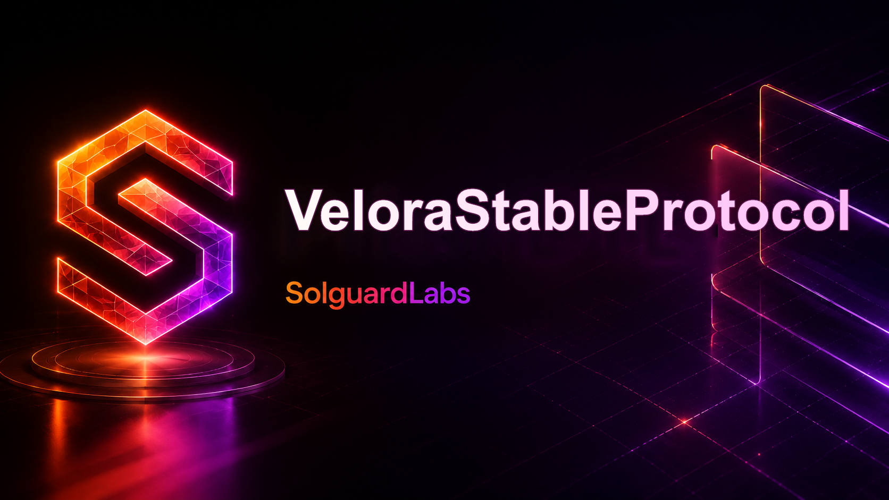

# Velora Stable Protocol



Velora es un protocolo de stablecoin sobrecolateralizada para activos ERC-20. El sistema
mantiene vaults aislados por activo, emite `VUSD` contra su valor de mercado y coordina
repagos, redenciones y liquidaciones mediante una contabilidad de deuda por participaciones.

## Componentes

- `VaultManager`: custodia colateral y orquesta el ciclo de vida de cada vault.
- `DebtLedger`: representa la deuda mediante shares y checkpoints de sincronización.
- `VeloraUSD`: token ERC-20 de 18 decimales con emisión y quema autorizadas por roles.
- `VeloraPriceOracle`: feeds administrados, heartbeat, límites de precio y parada operativa.
- `CollateralRegistry`: catálogo de activos, ratios, techos de deuda y normalización decimal.
- `LiquidationEngine`: cotizaciones deterministas y ejecución de posiciones liquidables.
- `RedemptionQueue`: solicitudes temporizadas de conversión de VUSD a colateral.
- `StabilityPool`: liquidez de VUSD para absorción de deuda y reparto de colateral.
- `SurplusPool`: custodia de excedentes reclamables por propietarios de vaults.
- `FeeController`: política acotada de comisiones de emisión y redención.

## Modelo económico

Cada tipo de colateral define:

- ratio mínimo de emisión;
- ratio de liquidación y bonus del liquidador;
- techo de deuda, depósito máximo y deuda mínima por vault;
- feed de precio normalizado a 18 decimales;
- comisión de redención.

La deuda global se distribuye mediante participaciones. Las operaciones que cambian deuda
materializan sus checkpoints antes de cerrar el ciclo de liquidación o redención. El riesgo
se expresa en basis points, usando precios vigentes del oráculo y los decimales registrados
para cada token.

Los activos admitidos deben conservar balances nominales estables: el registro no acepta como
colateral operativo tokens con rebases, comisiones de transferencia o cambios de decimales. En
esos casos debe utilizarse previamente un wrapper ERC-20 compatible.

## Requisitos

- Foundry 1.7 o superior.
- Solidity 0.8.28, instalado automáticamente por Forge.
- Bash para los wrappers de validación local.

## Construcción y tests

```bash
forge build
forge test -vvv
```

La validación equivalente a CI se ejecuta con:

```bash
bash scripts/ci.sh
```

Para ejecutar solo la suite:

```bash
bash scripts/tests.sh
```

En PowerShell se ofrecen wrappers equivalentes que usan el Foundry nativo de Windows:

```powershell
powershell -ExecutionPolicy Bypass -File ./scripts/ci.ps1
powershell -ExecutionPolicy Bypass -File ./scripts/tests.ps1
```

## Despliegue local

La configuración de ejemplo despliega los contratos y enlaza sus roles operativos:

```bash
anvil
forge script script/DeployVelora.s.sol:DeployVelora \
  --rpc-url http://127.0.0.1:8545 --broadcast
```

Las direcciones administrativas, treasury y parámetros de colateral deben adaptarse al
entorno antes de un despliegue persistente.

## Estructura

```text
src/
  access/       autorización y administración diferida
  core/         vaults, deuda, colateral y comisiones
  interfaces/   superficies compartidas
  libraries/    aritmética, valoración y transfers ERC-20
  modules/      liquidación y redención
  oracle/       publicación y consumo de precios
  pools/        estabilidad y excedentes
  token/        VUSD
  types/        estructuras del dominio
tests/          pruebas unitarias, fuzz e invariantes
script/         despliegue Foundry
scripts/        comandos reproducibles de CI
```

## Estado

El protocolo incluye flujos completos de apertura, depósito, emisión, repago, retiro,
liquidación, actualización de precios y redención. La suite Forge valida las invariantes
económicas y el wiring de permisos entre módulos.
