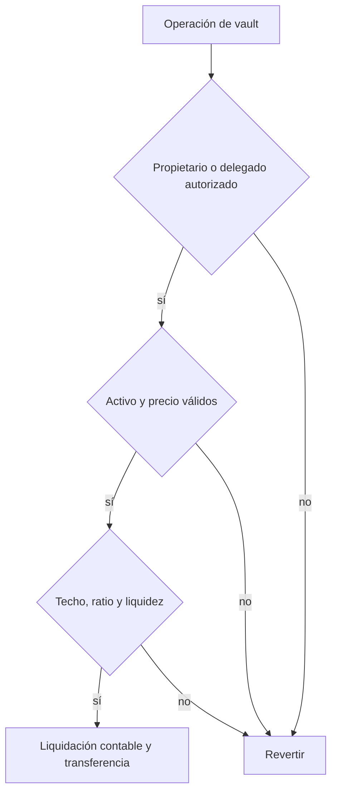

# Seguridad

## Modelo de confianza

Velora separa administración, reporting de precios, guardianes y ejecución operativa. Los
contratos de liquidación y redención reciben permisos limitados sobre `VaultManager`; la
capacidad de emitir y quemar VUSD se concede exclusivamente a los componentes de settlement.
La transferencia del administrador principal requiere propuesta, espera y aceptación.

Los reporters son responsables de publicar precios dentro de los límites configurados. Un
precio fuera de heartbeat, un feed pausado o una observación no válida bloquean las rutas que
dependen de valoración.



## Invariantes esperadas

- Un vault activo conserva propietario, activo de colateral y estado de deuda asociados.
- La emisión no supera el techo del colateral ni reduce el ratio bajo el mínimo configurado.
- La suma de deuda se representa mediante shares y un único total agregado.
- Un repago quema VUSD y reduce la obligación económica por el mismo importe.
- Los retiros conservan el ratio mínimo al precio vigente.
- Solo posiciones bajo el ratio de liquidación pueden ser liquidadas.
- Una redención consume VUSD bloqueado y entrega el colateral cotizado una sola vez.
- El Stability Pool no compensa más deuda que sus depósitos disponibles.
- Los excedentes solo pueden ser reclamados por su beneficiario contabilizado.
- Los transfers de tokens se completan o revierten de forma atómica.
- Los colaterales registrados no aplican rebases ni comisiones sobre transferencias.

## Controles automatizados

La validación local y de CI ejecuta:

```bash
forge fmt --check
forge build
forge test
```

La suite cubre permisos, límites del registro, caducidad del oráculo, lifecycle de vaults,
comisiones, liquidaciones, redenciones, fuzzing de ratios e invariantes de custodia.

## Dependencias

El proyecto fija la versión del compilador y usa `forge-std` como dependencia de desarrollo.
Dependabot revisa GitHub Actions. Cualquier actualización de toolchain debe ejecutar la suite
completa y revisar cambios de bytecode y tamaño de contratos.

## Alcance de revisión

Una revisión debe incluir contabilidad de shares, normalización decimal,
redondeos, freshness de precios, roles entre contratos, slippage, pausas y comportamiento ante
tokens ERC-20 no estándar. También debe verificar que cada transición conserva deuda, supply y
colateral a través de llamadas entre módulos.

## Formato de reporte

Los reportes internos deben indicar componente, precondiciones, secuencia reproducible,
invariante afectada, impacto económico, severidad, propuesta de mitigación y pruebas de
regresión recomendadas.

Los hallazgos deben comunicarse mediante **Report a vulnerability** de GitHub cuando esté
habilitado, o por un canal privado con los mantenedores. No se deben publicar detalles técnicos
antes de coordinar una respuesta ni compartir claves o datos de terceros. La revisión local no
demuestra exposición de activos en una red externa ni implica una auditoría independiente.
