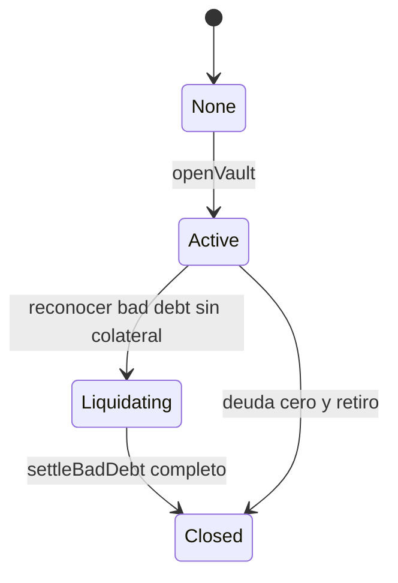

# Arquitectura y estados

`VaultManager` conserva el colateral de cada vault y coordina emisión, repago, retiro y cierre. `DebtLedger` conserva el agregado de deuda y las participaciones por vault. `CollateralRegistry` fija el activo, decimales, techos y ratios; `VeloraPriceOracle` aporta el precio con vigencia controlada. `VeloraUSD` limita emisión y quema a roles autorizados. `FeeController` cotiza comisiones dentro de curvas y caps configurados.

La liquidación ordinaria no cambia necesariamente el estado `Active`; el estado `Liquidating` se usa cuando se reconoce deuda incobrable después de agotar el colateral. `Frozen` existe en el tipo compartido, pero no tiene una transición pública en este manager. Las redenciones pasan por `RedemptionQueue`, que conserva solicitud, plazo, receptor y mínimo de salida. `LiquidationEngine` cotiza y ejecuta la cobertura; `StabilityPool` aporta VUSD depositado y `SurplusPool` conserva excedentes reclamables.

`VeloraPortfolioLens` es una vista independiente. Devuelve propietario, activo, colateral, estado, valor, deuda cotizada, ratio y bandera de liquidación para un vault o un lote. No guarda balances ni sustituye una simulación de la transacción de escritura.
