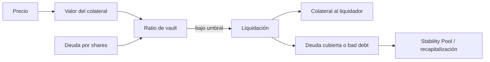

# Modelo económico

## Valoración

Cada colateral tiene decimales registrados y un feed con precio en VUSD por unidad completa, escalado a 18 decimales. El registro normaliza el importe y aplica el precio; los ratios se expresan en puntos básicos. Para importes aproximados:

```text
valor = colateral × precio / 10^decimales
ratioBps = valor × 10 000 / deuda
deuda máxima teórica = valor × 10 000 / minCollateralRatioBps
```

La división entera, los mínimos de deuda, techos, comisiones y precisión del token hacen que una calculadora externa pueda diferir por unidades marginales. Para decisiones se utiliza el estado y la cotización del contrato.

## Shares, repagos y oferta

`DebtLedger` distribuye la deuda mediante shares; un vault obtiene su porción de la deuda agregada según `shares / totalShares`. Un repago quema VUSD y reduce obligación; la sincronización materializa el cambio en shares. La oferta de VUSD, deuda emitida, bad debt y VUSD en Stability Pool son medidas distintas y se reconcilian por separado. Las comisiones de emisión forman parte de la deuda pero pueden enviarse a tesorería, por lo que la cantidad recibida por el usuario no siempre coincide con la deuda nueva.

## Estrés de precio y liquidación

Un vault con 100 WETH a 2.000 VUSD y 100.000 VUSD de deuda tiene valor de 200.000 y ratio 20.000 bps. Si el precio cae a 1.100, el valor baja a 110.000 y el ratio a 11.000 bps. Con umbral de liquidación de 12.000 bps, pasa a ser elegible para liquidación. El bonus y el colateral disponible limitan lo que recibe el liquidador; una caída extrema puede producir bad debt que requiere recapitalización.



El diseño no presupone que el peg se mantenga automáticamente: depende de colateral, incentivos de redención, profundidad de liquidez y respuesta operativa.
